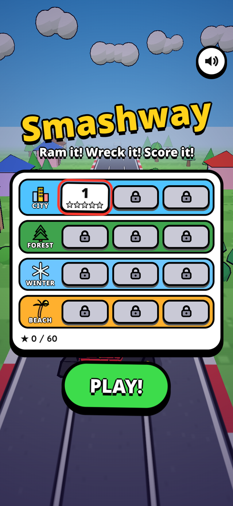
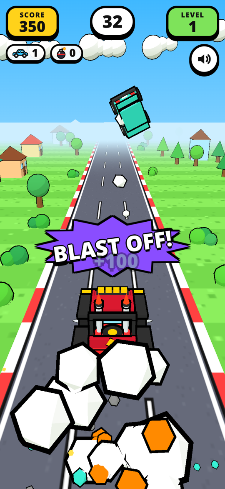
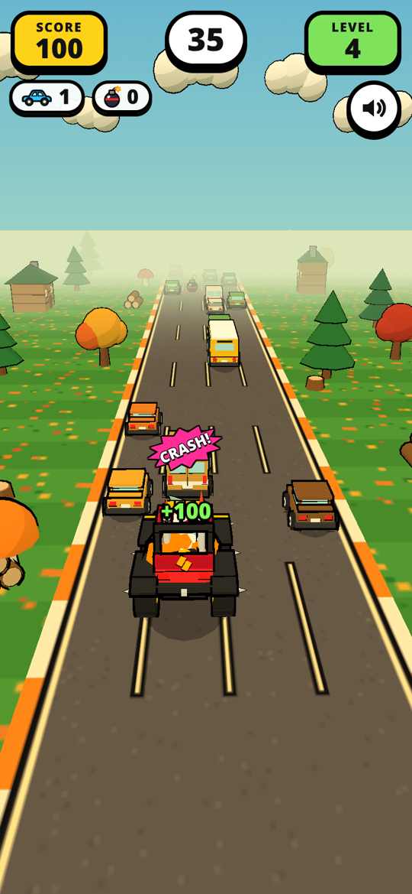
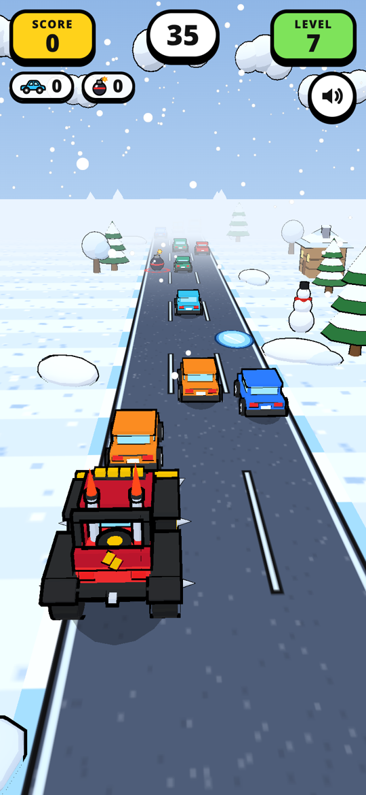
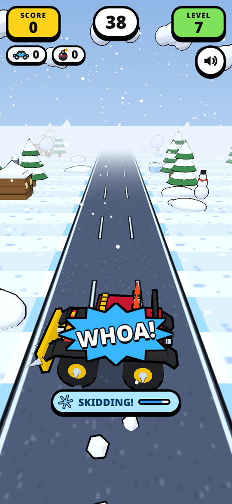
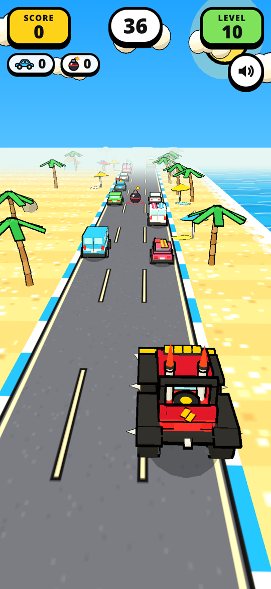
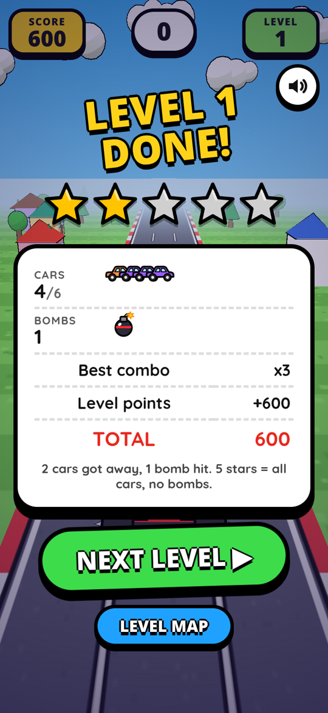

# Smashway

**Ram it! Wreck it! Score it!** A cartoon monster-truck game for Android by KolmeCode.

Drive a badass monster truck down a busy highway and ram as many cars as you can before the minute runs out. Cars wreck in all kinds of crazy ways. Dodge the bombs, skid on ice, and collect up to 5 stars on every level.

- 12 levels in 4 worlds: City, Forest (4 lanes!), Winter (icy roads) and Beach (fastest traffic)
- Tap a lane or swipe left/right to steer
- No ads, no tracking, no internet needed

## Download

Get the latest APK from **[Releases](https://github.com/fasec/smashway-releases/releases/latest)** and open it on your Android phone (Android 7.0 or newer). You may need to allow "Install unknown apps" for your browser.

## Screenshots

| | | |
|:-:|:-:|:-:|
|  |  |  |
|  |  |  |
|  | | |

---
© KolmeCode. This repository only hosts release downloads.
